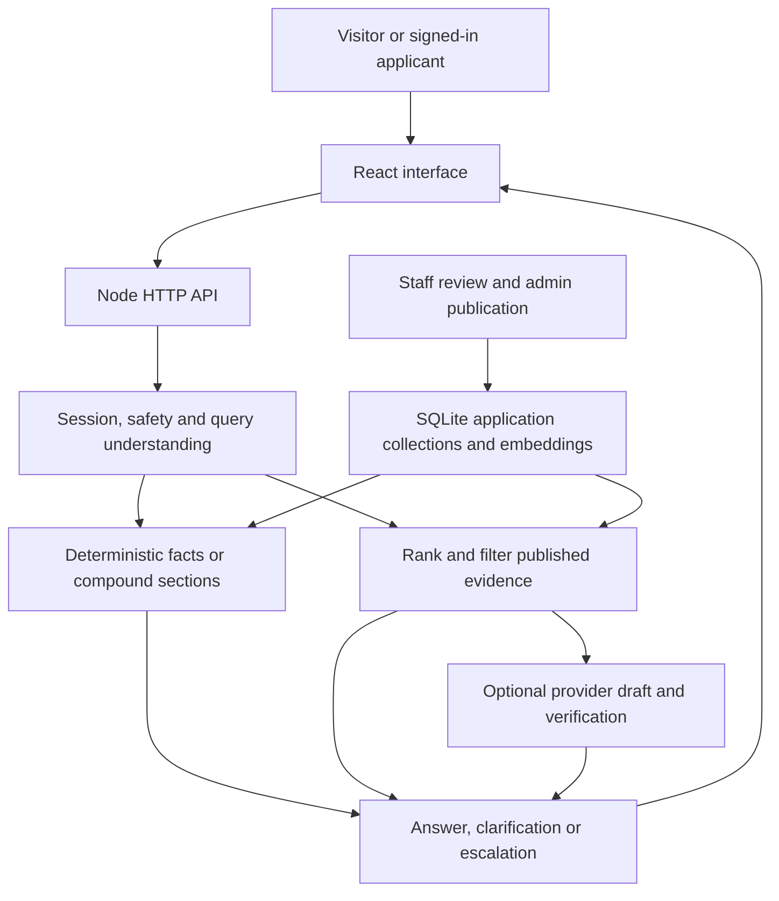

# Mitra final-project viva guide

## Opening · about 1 minute

> Good morning. Our project is Mitra, a virtual assistant for MIT College of Railway Engineering and Research, Barshi. Applicants and parents often have to check several pages and notices to find the right fee, document list, or admission rule. The answer can change with the year, admission route, or fee category.
>
> With Mitra, they can ask in a chat. The system checks the question against published college records, asks for missing details, and shows the supporting record when available. Applicants can use the admissions checklist as guests and sign in to save progress.
>
> We’ll show a fee question and a follow-up, then explain how Mitra finds the answer, protects private information, and checks its results.

## Four-person presentation and demo

This plan covers the full website. Each person has a clear part and a line to pass to the next speaker. It takes about 15 minutes and can stretch to 20 minutes if the examiners invite more detail. Reserve any remaining time for questions.

| Time | Speaker | What to show |
| --- | --- | --- |
| 0:00–4:00 | **Member 1** | Opening, public chat, fee question and follow-up |
| 4:00–8:00 | **Member 2** | Admission inquiry, public information and source links |
| 8:00–12:00 | **Member 3** | Guest checklist and optional saved progress |
| 12:00–15:00 | **Member 4** | Admin knowledge review, technical workflow, tests and closing |
| 15:00–20:00 | **All members** | Optional feature example, then examiner questions |

### Member 1 · Opening and public chat · 4 minutes

Say the opening above. Then show the main website and chat.

1. Point out that a visitor can ask a question without signing in.
2. Ask, “What are the first-year B.Tech fees for Open category?”
3. If Mitra asks for a missing detail, answer it on screen.
4. Ask, “What about OBC?” Explain that Mitra keeps the course and year from the earlier question and changes the fee category.
5. Point to the answer’s source or evidence, if shown.

**Say:** “This example shows how a visitor asks a question, how Mitra remembers useful details for a follow-up, and how the answer connects to a published college record.”

**Hand off:** “I’ve shown the public chat. The next presenter will now show how a student can ask about admission and find the official next steps.”

### Member 2 · Admission inquiry and information · 4 minutes

1. Open the admission inquiry or assistant area.
2. Ask a prepared question, such as “What documents are needed for first-year admission?” Use a question that you have checked on the demo site.
3. Show any follow-up question, answer sections, or official links that appear.
4. Explain that Mitra provides guidance from available college information. The college and admission authorities make the final admission decisions.
5. If the page offers a way to send a question to staff, show where it goes. It appears in the staff review queue and does not automatically send an email or message.

**Say:** “Mitra can answer from published information and point the visitor to an official next step. If it cannot answer confidently, the visitor can ask staff.”

**Hand off:** “The public inquiry is one part of the website. The next presenter will show the guest checklist and optional sign-in.”

### Member 3 - Admission checklist and optional sign-in (4 minutes)

1. Ask MITRA, "I got MITCORER in CAP. What do I do now?"
2. Open the checklist as a guest and choose a route and the Centralized CAP process.
3. Mark the latest completed step and a document as prepared. Show the next official action and its link.
4. Select **Save my checklist**, sign in with the demo account and save. Reopen the checklist to show the saved progress.

**Hand off:** “We’ve seen the applicant side. The next presenter will show how staff maintain the answers and explain how the system works behind the website.”

### Member 4 · Staff, admin and technical explanation · 3 minutes

1. Open **Saved admission checklists** to show self-reported progress. Open **Review Inbox** to show where visitor questions and feedback go.
2. Show the admin knowledge or official-source review screen. Explain that an admin checks information before publishing it for chat answers.
3. Give the short technical path: “React sends the question to the Node.js API. The backend understands its topic and details, looks up published records in SQLite, and returns the answer and available evidence. Some open-ended questions can use an AI draft, which is checked before display.”
4. State one validation result accurately: “Our saved local run passed 150 out of 150 bounded checks. That is a test result, not a guarantee of perfect accuracy. Semantic review found two unsuitable answers that we then corrected and covered with tests.”
5. Close by naming the limits: “Independent institutional and language review, and production load testing, are still pending.”

**Closing:** “That completes our demonstration. We’re ready for your questions.”

### If the exam gives you 20 minutes

Keep the four-person order and add one optional feature demo to the relevant speaker’s section:

- Member 1 can show a supported Marathi or Hindi question and explain that some answers may use an English fallback.
- Member 2 can ask a question with two parts, such as academic fees and hostel fees, and show the separate answer sections.
- Member 4 can explain the D11 restart bug: an update used to restore intentionally deleted sources. The fix records completed updates and tests that an empty source list stays empty after restart.

### Demo preparation

- Sign in to the test applicant and staff/admin accounts before the presentation.
- Check the prepared questions, published records and sample upload on the same demo setup you will present.
- Keep the presenters’ accounts and roles separate. Sign out before switching roles.
- If a page or model is slow, explain what it should show and continue to the next part.
- Each member should know the overall workflow, then focus on their assigned section.

## How Mitra works

### In normal words · 30 seconds

1. **Ask.** The user types a question in the chat.
2. **Understand.** Mitra works out what the user wants and looks for details such as the year, admission route, and fee category. It can ask a follow-up if a detail is missing.
3. **Find the answer.** For a fee question, Mitra looks up the matching published college record. For some open-ended questions, AI can help write an answer using relevant records, and Mitra checks the draft.
4. **Reply.** The chat shows the answer and the supporting record or link when available. If Mitra cannot find enough information, it says so and can point the user to staff.

**Example.** After a first-year B.Tech fee question, the user asks, “What about OBC?” Mitra can keep the first-year B.Tech details from the previous turn, change the fee category to OBC, and look for the matching published fee.

### In technical words · 45 seconds

1. **Send and validate.** The React frontend sends the question as JSON to the Node.js API at `POST /api/public-assistant/ask`. The backend checks the request and loads any relevant chat context linked to that browser session.
2. **Parse and route.** The backend maps common wording to standard terms, detects the **intent** (for example, a fee lookup), and extracts **slots** (details such as year, route, and category). In “What about OBC?”, it updates the category and can reuse the previous route.
3. **Retrieve and answer.** The fee lookup reads the matching published record from knowledge loaded from SQLite. Eligible open-ended questions can use **RAG**, which means finding relevant passages first and then giving them to an optional AI model. The backend checks the draft against the evidence before accepting it.
4. **Return and display.** The API sends JSON with the answer, its outcome, and any available evidence or links. React displays the result. If the backend needs more detail or lacks enough evidence, it can return a clarification or say the answer is unavailable.

## Repository orientation

Start with the [file shortlist](MITRA_VIVA_FILE_INVENTORY.md). The two application source trees contain backend and frontend modules plus UI assets. The shortlist covers the implementation, key tests, deployment configuration and validation evidence. Walk through one request in this order:

1. [main.jsx](../frontend/src/main.jsx) mounts the React application. [App.jsx](../frontend/src/App.jsx) owns the public widget and the relevant application views. [api.js](../frontend/src/api.js) sends the JSON request through [request-json.mjs](../frontend/src/request-json.mjs).
2. [server.js](../backend/src/server.js) receives `POST /api/public-assistant/ask`, validates and rate-limits it, and uses [public-session.js](../backend/src/public-session.js) and [conversations.js](../backend/src/conversations.js) for session-owned context.
3. [language.js](../backend/src/language.js), [query-understanding.js](../backend/src/query-understanding.js) and [query-scope.js](../backend/src/query-scope.js) normalize wording and resolve topic and qualifiers. [question-plan.js](../backend/src/question-plan.js) handles supported compounds and clarification.
4. [knowledge.js](../backend/src/knowledge.js) selects and renders maintained fee/intake facts. [store.js](../backend/src/store.js) loads and persists records. [provenance.js](../backend/src/provenance.js) checks source availability, and [evidence.js](../backend/src/evidence.js) builds the public evidence snapshot.
5. The JSON response carries the answer and available evidence, outcome, links and language metadata. [answer-format.mjs](../frontend/src/answer-format.mjs) produces bounded formatting for headings, lists and tables that React renders.

## Stack and engineering choices

| Area | What we use | Why it fits and what it costs |
| --- | --- | --- |
| Interface | React 19, JSX, CSS, Lucide React; Vite 8 | Component state fits chat, async feedback and staff views. Vite builds static assets and proxies /api in development. App.jsx houses several workflows and is a candidate for modularization as they grow. |
| Backend | JavaScript ES modules, Node 22, native HTTP and fetch | One runtime and a small dependency surface. Routing, validation, parsing and security are application responsibilities. |
| Persistence | Built-in node:sqlite, application JSON in collections, separate vector_embeddings table; source and upload files on disk | Durable single-instance deployment with low setup overhead. Whole-collection updates and in-process state limit concurrent multi-instance writes, querying and database-enforced relationships. |
| Retrieval | Weighted keywords, rules, concept aliases, optional Gemini embeddings and cosine similarity, scope-aware reranking; BM25 and rank fusion in evaluation tooling | Exact domain terms and semantic variants complement each other. Published status and year/branch/route constraints matter more than a high generic score. |
| Generation | Optional Groq then Gemini when both configured; deterministic fallback | Selected eligible questions can get synthesized guidance. A provider is an external dependency with latency, cost and verification limits. |
| Ingestion | Maintained records, website sync staging, Python extraction/data tools, Poppler PDF extraction, Tesseract OCR where available | Separate capture, text extraction, review and publication. DOCX/XLSX can require reviewed text supplied manually. |
| Tests | Node test runner, Oxlint, Playwright Core browser scripts, GitHub Actions; separate evaluation scripts | Unit and regression coverage plus browser journeys. Evaluation designs measure different properties. |
| Deployment | Vite dev proxy; Docker Compose with Nginx; Vercel rewrite and Render backend configuration | One frontend API path across environments. Persistent files, HTTPS, cookies, secrets, trusted proxies and a post-release smoke test are operational requirements. Current local validation is distinct from a verified live release. |

## Technical viva questions and model answers

Start with questions 1, 8, 12, 13, 16, 21, 24, 29, 37 and 40. Answer in one or two sentences first. Keep the other questions for practice or follow-ups.

### Product and architecture

1. **What problem are you solving?** Applicants and parents need college answers that match their situation. Mitra brings published information and admissions guidance into one place.
2. **What is the project's main contribution?** Mitra remembers details across short follow-ups and shows where an answer came from. We can demonstrate both with the fee example.
3. **Is the system an admission decision engine?** Mitra gives guidance and tracks submissions. Authorized bodies still decide admissions and scholarships. Intake is the approved number of seats, vacancies are seats available now, and cutoff is a past admission result.
4. **Why a modular monolith?** We use one backend process with separate modules inside it. That keeps setup simple while giving login, answers and storage their own code.
5. **What are your main API flows?** An API is how the UI asks the backend to do something. Chat sends a POST request to `/api/public-assistant/ask`. Public facts use a GET request. A knowledge edit sends a PATCH with the record version the editor saw.
6. **How do users escalate?** A visitor can send a question to the staff inbox. Staff can then assign and handle it.
7. **How does streaming work?** The backend can stream an answer it has already built. The public chat currently receives the whole answer as JSON after checks finish.

### Query understanding, retrieval and AI

8. **Trace a fee question.** The backend reads the question and picks out the year, admission route and category. It asks for missing details, then looks up the matching published fee record and returns the amount with its evidence.
9. **What is intent versus a slot?** Intent means what the user wants, such as a fee. A slot is a detail that narrows it down, such as the year or category. Common alternate words are mapped to the same meaning.
10. **What prevents branch or year substitution?** The backend carries the requested branch, year, exam and round through the lookup. If the available record is for a different scope, Mitra explains the gap or asks a question.
11. **What happens for two questions at once?** Mitra can answer supported parts separately. If one part still needs clarification, the response can say `PARTIALLY_ANSWERED`.
12. **How do follow-ups work?** The backend remembers a few useful details, such as year and admission route. A new detail overrides the old one. A browser cookie ties public chat to the same browser, and the history expires.
13. **What is RAG here?** RAG means retrieval-augmented generation. Mitra finds relevant records first and can give their passages to an AI model to help write an answer. Many questions are answered directly from published data.
14. **Where does BM25 fit?** BM25 ranks text using matching words, how rare they are, and how long the document is. Fielded BM25 can give a title more weight than body text. We compare BM25 and rank fusion in evaluation tools. The live API uses weighted search and reranks results for question details.
15. **What do embeddings add?** An embedding is a list of numbers that represents text. Cosine similarity compares those lists so different wording can still match. Mitra stores the vectors in SQLite and ties them to the model and source text.
16. **How is accuracy of generated text constrained?** The backend gives the model reference passages and checks the draft for unsupported numbers or mismatched details. If a provider fails or a draft is rejected, Mitra can try the next provider, return stored guidance, or say it lacks evidence. These checks can miss some mistakes.
17. **Why avoid the model on high-stakes numeric queries?** A fee should come from the correct published table row. Looking it up directly is predictable and avoids unnecessary model calls.
18. **Did you train a model?** We use optional existing models. Our work is the retrieval, answer rules, source tracking and checks around their use.
19. **How do you handle prompt injection?** A question or retrieved document might contain instructions trying to change the model’s behavior. Mitra screens common patterns, tells the model to treat documents as reference material, and checks the draft. These controls cover specific cases.
20. **How does multilingual support work?** Users can select English, Marathi or Hindi. Mitra also recognizes some common native and Romanized phrases. It can format supported facts and use reviewed translations tied to the source text. It tells the user when it falls back to English.

### Data, security and operations

21. **Explain the actual schema.** SQLite stores users, documents and knowledge as collections in a JSON-backed application record. Embeddings have their own table. This is simple to run on one instance. Shared, normalized storage could help if the system grows.
22. **What is the difference between a seed and a migration?** A seed creates starting data for a new database. A migration updates a database that already exists. D11 showed that a new database needs to record completed migrations and that an empty source list can be intentional.
23. **How do you protect simultaneous admin edits?** The editor sends the record version it opened. If someone saved a newer version, the backend rejects the older edit with HTTP 409 so it cannot overwrite the newer work.
24. **What does a citation prove?** A citation shows which record version and passage Mitra used. A hash is a fingerprint of the passage. A person still needs to check whether the passage supports the claim and whether the source is current.
25. **How do updates reach chat?** An admin reviews text from a sync or upload before publishing it. Published passages can be used in chat. A new publication can replace earlier passages, and retired or unavailable records are excluded according to their saved status.
26. **How do you prevent stale cached answers?** The cache stores answers for reuse. Mitra checks if the supporting record changed, expired or was removed before reusing an answer. Private account answers stay out of the shared cache.
27. **How are passwords stored?** We store a salted PBKDF2-SHA256 password hash with 120,000 iterations. The salt makes equal passwords produce different stored values, and the backend compares hashes using constant-time equality.
28. **Is the access token a JWT?** The access token uses a custom two-part HMAC signature and expires after 15 minutes. Its contents can be read, and the signature detects changes. The refresh token is separate and stored as a hash on the server.
29. **How does MITRA protect a saved checklist?** The API checks the signed-in account before returning or saving progress. Authorized staff can view saved progress for admissions support.
30. **How does MITRA use official source files?** An admin reviews them before their text can become public answer evidence.
31. **How are failures handled?** The backend returns a status that explains the type of failure. The UI shows an error if the request takes too long and lets users retry. If the first chat request already reached the server, a retry may add another turn.
32. **What about XSS, CSRF and brute-force attempts?** React renders supported formatting as UI elements and text. The app checks links, uses SameSite cookies and applies rate limits. Backend role and ownership checks still decide access.
33. **What would break at higher load?** The backend uses local files, an in-memory rate limit and whole-state updates. At higher load, we would measure slow requests and write conflicts before choosing shared database or file storage.
34. **How do you deploy and recover it?** Build the frontend, send API requests to the Node service and configure persistent files, secrets and health checks. Test guest checklist access and saved checklist recovery after release. Back up the database and files together.
35. **What observability exists?** Backend logs can show which answer route ran, how long it took and which evidence was used. Audit events help trace privileged changes.

### Evaluation and examiner follow-ups

36. **How did you test the system?** We test code rules, HTTP requests and browser workflows. The saved isolated run checked the local implementation with model generation turned off.
37. **Does 150/150 mean 100% accuracy?** 150/150 means all 150 cases passed the assertions we wrote. A later review still found two unsuitable answers that had passed. We corrected those cases and added tests for them.
38. **How would you independently evaluate it?** Freeze the app and source versions, use unseen questions and ask independent reviewers to check answers and citations. Ask competent speakers to review Marathi and Hindi. Report those results separately from speed and test counts.
39. **How do you measure retrieval independently of generation?** Recall@K is the share of all relevant records found in the first K results. Precision@K is the share of the first K results that are relevant. MRR gives more credit when the first relevant result appears earlier.
40. **Give an engineering bug you solved.** After restart, a migration added deleted crawl sources back. The fix records completed migrations during initialization and preserves an intentionally empty source list. Restart tests cover new and older databases.
41. **What remains weak?** Some scholarship questions need more precise records, and some native-language answers fall back to English. Independent reviews, current live deployment checks and production load measurements are still pending.
42. **What would you do next with one week?** We would fix the remaining answer gaps using approved records and ask independent reviewers to check unseen questions, including Marathi and Hindi.
43. **How do you respond to conflicting official sources?** If official sources disagree, show the conflict and point the user to the current authority. We recorded a 2026–27 AI & Data Science choice-code disagreement between college material and CET Cell.
44. **How do you choose between two retrieval configurations?** Run both methods on the same questions and records. Compare which evidence each retrieves, what it misses, and how long it takes. Then check whether the change actually improves answers.

## Saved validation evidence

| Check in latest saved local run | Result | Scope |
| --- | --- | --- |
| Backend and frontend | 282/282 and 22/22 | Automated suites |
| Focused Phase A and review regressions | 12/12 | Targeted backend scenarios |
| Public development and workflow | 36/36 and 500/500 | Developer-authored evaluators |
| Original 150 questions | 150/150 bounded checks | Exposed development diagnostic |
| Browser checks | 47 passed | Width, language and answer matrix plus focused edge checks |
| Account/maintenance journeys and static checks | Public session and maintainer journeys, build and lint passed | Isolated environment |

The source is the saved post-review run dated 18 November 2026. The viva preparation used those artifacts. The earlier Phase A report and D11 report record earlier snapshots and totals. [Post-review report](answer-review/AI_REVIEW.md) · [Runner stage results](answer-review/ai-validation/validation.json)

## Last rehearsal

- Each teammate gives the opening in their own words, traces one request through five files, and answers one follow-up about failure behavior.
- Rehearse the difference between published evidence, a passage fingerprint, institutional verification, and independent evaluation.
- Keep the API guide, inventory and saved results open. Quote figures only from the year and category shown in the demo record.
